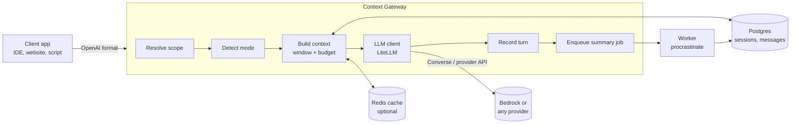

# Context Gateway

Context Gateway is a self-hosted HTTP service that gives stateless LLM APIs a memory. You point an OpenAI-compatible client at the gateway instead of the provider. The gateway stores each conversation, rebuilds the context for every call, keeps it inside a token budget, and folds old turns into a rolling summary. Provider calls go through LiteLLM, so AWS Bedrock (Claude), OpenAI, Anthropic, Gemini and others all work.

LLM APIs remember nothing. Every call has to carry the whole conversation. Each project ends up rebuilding the same code: store history, trim it to fit the context window, summarize old turns, keep users apart. This service is that code, written once.

This release is Phase 1: short-term (session) memory. Long-term fact memory is on the [roadmap](#roadmap-and-license).

## How it works



- **Scope.** A conversation is identified by `(app, user, session)`. The gateway reads them from headers, the URL path, or the body `user` field.
- **Modes.** A client that sends only the newest message is `stateless`. The gateway adds the stored history. A client that resends the whole history is `stateful`. The gateway does not add history again. It still records the chat and enforces the budget.
- **Budget.** The gateway keeps the prompt under `CTX_CONTEXT_BUDGET_TOKENS`. It drops the oldest turns first and never splits a tool call from its result.
- **Summary.** When unsummarized history passes `CTX_SUMMARY_TRIGGER_TOKENS`, a background job folds the oldest turns into a rolling summary. The summary goes into the prompt as a memory block.
- **Headers.** Every response says what memory did: mode, scope, turns included and dropped, whether a summary was used, and estimated prompt tokens.

If the memory layer fails (for example the database is down), the request still goes through without memory and the response says `X-Memory-Mode: degraded`.

## Quickstart with Docker Compose

```bash
cp .env.example .env
# Set AWS credentials (env vars, or an AWS_PROFILE with ~/.aws mounted) and check CTX_MODEL_ALIASES.
docker compose up --build
```

This starts Postgres, Redis, a one-shot migration, the gateway on port 8080, and a worker for summaries. Bedrock model ids depend on your region and account. Use one that is enabled in your Bedrock console.

Two calls that remember:

```bash
curl -s http://localhost:8080/v1/chat/completions \
  -H "Content-Type: application/json" \
  -H "X-Memory-User: alice" \
  -d '{"model": "claude", "messages": [{"role": "user", "content": "My name is Alice."}]}'

curl -s -i http://localhost:8080/v1/chat/completions \
  -H "Content-Type: application/json" \
  -H "X-Memory-User: alice" \
  -d '{"model": "claude", "messages": [{"role": "user", "content": "What is my name?"}]}'
```

The second answer knows the name. Its headers show `X-Memory-Mode: stateless` and `X-Memory-History-Turns: 1`. If you set `CTX_API_KEYS`, add `-H "Authorization: Bearer <key>"`.

## Quickstart without Docker

You need Postgres and Redis installed. The script starts private copies under `.devdata/`. Redis is optional.

```bash
uv sync
scripts/dev-services.sh start
eval "$(scripts/dev-services.sh env)"
uv run context-gateway migrate
CTX_LLM_BACKEND=echo CTX_DEFAULT_MODEL=echo uv run context-gateway serve
```

The `echo` backend needs no credentials. It replies with what it received, for example `echo: What is my name? | history_messages=2 | summary=no`. `CTX_DEFAULT_MODEL` must be set for summaries to run, even with `echo`. Summaries run inside the gateway process unless you set `CTX_JOB_BACKEND=procrastinate` and start `uv run context-gateway worker`.

Stop the services with `scripts/dev-services.sh stop`.

## Use from code

Any client that lets you change the base URL works. Scope goes in headers.

**Python (`openai` SDK)**

```python
from openai import OpenAI

client = OpenAI(
    base_url="http://localhost:8080/v1",
    api_key="any-string",  # or a key from CTX_API_KEYS
    default_headers={
        "X-Memory-App": "my-app",
        "X-Memory-User": "alice",
        "X-Memory-Session": "support-42",
    },
)

client.chat.completions.create(
    model="claude", messages=[{"role": "user", "content": "My name is Alice."}]
)
reply = client.chat.completions.create(
    model="claude", messages=[{"role": "user", "content": "What is my name?"}]
)
print(reply.choices[0].message.content)
```

**TypeScript (`openai` package)**

```typescript
import OpenAI from "openai";

const client = new OpenAI({
  baseURL: "http://localhost:8080/v1",
  apiKey: "any-string", // or a key from CTX_API_KEYS
  defaultHeaders: {
    "X-Memory-App": "my-app",
    "X-Memory-User": "alice",
    "X-Memory-Session": "support-42",
  },
});

const reply = await client.chat.completions.create({
  model: "claude",
  messages: [{ role: "user", content: "What is my name?" }],
});
console.log(reply.choices[0].message.content);
```

**curl, with scope in the path**

Clients that cannot set headers can put the scope in the URL: `/scope/{app}/{user}/{session}/v1/...`. Headers still win over the path.

```bash
curl -s http://localhost:8080/scope/my-app/alice/support-42/v1/chat/completions \
  -H "Content-Type: application/json" \
  -d '{"model": "claude", "messages": [{"role": "user", "content": "Hello"}]}'
```

Streaming works the same way with `"stream": true`.

## Use from IntelliJ (Continue plugin)

Add a model to the Continue `config.yaml`:

```yaml
models:
  - name: Claude via Context Gateway
    provider: openai
    model: claude
    apiBase: http://localhost:8080/scope/intellij/<you>/auto/v1
    apiKey: <gateway key or any string>
    requestOptions:
      headers:
        X-Memory-Mode: stateful
```

Replace `<you>` with your user name. The session `auto` gives each chat its own session, based on a fingerprint of its first user message.

The `X-Memory-Mode: stateful` header is optional but recommended. Without it, the first message of a new chat has no assistant reply yet, so the gateway treats it as stateless and uses the shared `default` session for that app and user. Later messages in the same chat are detected as stateful and get their own session.

Any plugin that accepts a custom OpenAI-compatible base URL works the same way.

## Memory modes and headers

| Mode | When | What the gateway does |
|---|---|---|
| `stateless` | The request has no assistant, tool or function messages. | Adds stored history and the summary. Records the new turn. Starts summaries. |
| `stateful` | The request already carries assistant, tool or function messages. | Sends the client's messages, trimmed to the budget. Records only messages the store does not have yet. No summary in Phase 1. |
| `off` | You send `X-Memory-Mode: off`. | Forwards the request unchanged. Stores nothing. |
| `degraded` | Reported only. The memory layer failed. | Forwards the request unchanged. Stores nothing. |

Request headers:

| Header | Meaning |
|---|---|
| `X-Memory-App` | App name. Default `CTX_DEFAULT_APP`. |
| `X-Memory-User` | User id. Falls back to the path, then the body `user` field, then `anonymous`. |
| `X-Memory-Session` | Session key. Default `auto`: `default` for stateless clients, a first-message fingerprint (`fp-...`) for stateful ones. |
| `X-Memory-Mode` | `auto` (default), `stateless`, `stateful` or `off`. |
| `X-Request-Id` | Optional. The gateway reuses it, or makes one. |
| `Authorization: Bearer <key>` or `X-Api-Key` | Needed only when `CTX_API_KEYS` is set. |

Scope values use 1 to 128 characters from `A-Z a-z 0-9 . _ : @ -`.

Response headers on every chat reply, including streams:

| Header | Value |
|---|---|
| `X-Memory-Mode` | `stateless`, `stateful`, `off` or `degraded` |
| `X-Memory-App`, `X-Memory-User`, `X-Memory-Session` | The resolved scope. Left out in `off` mode. |
| `X-Memory-History-Turns` | History turns included in the prompt |
| `X-Memory-Dropped-Turns` | History turns dropped to fit the budget |
| `X-Memory-Summary` | `used` or `none` |
| `X-Memory-Prompt-Tokens` | Estimated prompt tokens sent |
| `X-Request-Id` | The request id |

Errors use the OpenAI shape: `{"error": {"message", "type", "param", "code"}}`. Provider errors keep their 4xx status. Other provider failures return 502.

## Configuration

Settings come from `CTX_*` environment variables or a `.env` file. `.env.example` lists every one with a short comment. Invalid values stop the process at startup with a message.

| Variable | Default | Meaning |
|---|---|---|
| `CTX_STORE` | `postgres` | `postgres` or `memory` (demos and tests) |
| `CTX_DATABASE_URL` | `postgresql://cg:cg@localhost:5432/cg` | Postgres connection string |
| `CTX_REDIS_URL` | empty | Redis for the window cache. Empty disables it. |
| `CTX_JOB_BACKEND` | `inline` | `inline` or `procrastinate` (separate worker) |
| `CTX_LLM_BACKEND` | `litellm` | `litellm` or `echo` |
| `CTX_TOKEN_COUNTER` | `litellm` | `litellm` or `heuristic` |
| `CTX_DEFAULT_MODEL` | empty | Alias or LiteLLM model string used for `default` or no model |
| `CTX_MODEL_ALIASES` | `{}` | JSON map from client model name to LiteLLM model string |
| `CTX_ALLOW_UNLISTED_MODELS` | `true` | Pass names that are not aliases through unchanged |
| `CTX_SUMMARY_MODEL` | empty | Model for summaries. Falls back to the default model. |
| `CTX_CONTEXT_BUDGET_TOKENS` | `24000` | Most prompt tokens sent |
| `CTX_SUMMARY_TRIGGER_TOKENS` | `8000` | Unsummarized tokens that start a summary |
| `CTX_SUMMARY_KEEP_RECENT_TOKENS` | `3000` | Newest tokens never folded. Must be below the trigger. |
| `CTX_SUMMARY_MAX_FOLD_TOKENS` | `12000` | Most tokens folded per job |
| `CTX_SUMMARY_MAX_OUTPUT_TOKENS` | `800` | `max_tokens` for the summary call |
| `CTX_WINDOW_MAX_TURNS` | `200` | Newest turns loaded per request |
| `CTX_CACHE_TTL_SECONDS` | `600` | Lifetime of a cached window |
| `CTX_API_KEYS` | empty | Comma-separated gateway keys. Empty disables auth. |
| `CTX_DEFAULT_APP` | `default` | App name when none is given |
| `CTX_CORS_ORIGINS` | empty | Comma-separated origins. Empty disables CORS. |
| `CTX_LOG_LEVEL` | `INFO` | Log level |
| `CTX_LOG_CONTENT` | `false` | Log message text. Never logs credentials. |
| `CTX_HOST`, `CTX_PORT` | `0.0.0.0`, `8080` | Bind address for `serve` |

**Provider credentials** are the standard variables that LiteLLM and boto3 read, for example `AWS_ACCESS_KEY_ID`, `AWS_SECRET_ACCESS_KEY`, `AWS_SESSION_TOKEN`, `AWS_REGION_NAME`, `AWS_PROFILE` and `OPENAI_API_KEY`. Clients never send them. They live in the gateway environment.

The gateway holds provider credentials. Run it on a private network, or behind TLS with `CTX_API_KEYS` set.

Summaries need a model. Set `CTX_SUMMARY_MODEL` or `CTX_DEFAULT_MODEL`, or the gateway logs a warning and skips them.

## Memory admin API

Path segments are literal scope values. `auto` is not resolved here. All routes need the gateway key when `CTX_API_KEYS` is set.

| Method | Path | Purpose |
|---|---|---|
| GET | `/memory/v1/sessions/{app}/{user}/{session}` | Session info: summary, turn and message counts, unsummarized tokens. 404 if missing. |
| GET | `/memory/v1/sessions/{app}/{user}/{session}/messages?limit=50` | Most recent stored messages, oldest first. `limit` is 1 to 500. |
| DELETE | `/memory/v1/sessions/{app}/{user}/{session}` | Delete the session and its messages. 204, or 404. |
| POST | `/memory/v1/sessions/{app}/{user}/{session}/summarize` | Queue a summary job now. 202 `{"enqueued": true}`. |
| POST | `/memory/v1/context/preview` | Dry run of context assembly. No LLM call, no writes. |
| GET | `/v1/models` | Model aliases (and `default` when set). Also at `/scope/{app}/{user}/{session}/v1/models`. |
| GET | `/healthz` | Liveness. |
| GET | `/readyz` | Readiness: checks the store and Redis. 200 or 503. |

The preview body is a chat body plus an optional `"scope": {"app", "user", "session"}` and an optional `"memory_mode"`. It returns the messages that would be sent and the same report the headers carry.

## Development

```bash
uv sync
uv run ruff check . && uv run ruff format --check .
uv run pytest                      # unit and API tests; integration tests skip without services
```

Integration tests need Postgres and Redis. Start local ones and point the tests at them:

```bash
scripts/dev-services.sh start
TEST_DATABASE_URL=postgresql://cg:cg@127.0.0.1:55432/cg_test \
TEST_REDIS_URL=redis://127.0.0.1:56379/0 \
uv run pytest
```

Without `TEST_DATABASE_URL` or `TEST_REDIS_URL`, the tests try to start containers with testcontainers, and skip when Docker is not available. CI runs the same suite against `pgvector/pgvector:pg16` and `redis:7-alpine` services.

Unit and API tests never import LiteLLM. They use a scripted fake LLM, the heuristic token counter and the in-memory store.

Migrations: `context-gateway migrate` runs Alembic and is safe to run again. The first revision creates the `cg_sessions` and `cg_messages` tables. The second applies the procrastinate job schema. To upgrade procrastinate later, apply its own migration files in a new Alembic revision.

The full technical specification, with the algorithms and the reasoning behind them, is in [CLAUDE.md](CLAUDE.md). Deviations from it are listed in [docs/DECISIONS.md](docs/DECISIONS.md).

## Roadmap and license

| Phase | Scope |
|---|---|
| 2 | Long-term memory: fact extraction, reconcile, embeddings, pgvector and full-text retrieval, `remember` / `recall` / `forget` API, Python and TypeScript SDKs. |
| 3 | Context inspector UI, eval suite, per-app API keys, retention and forget-everything for a user. |
| 4 | MCP server, time-aware queries, Vercel AI SDK and LangGraph adapters. |

Licensed under the Apache License 2.0. See [LICENSE](LICENSE).
